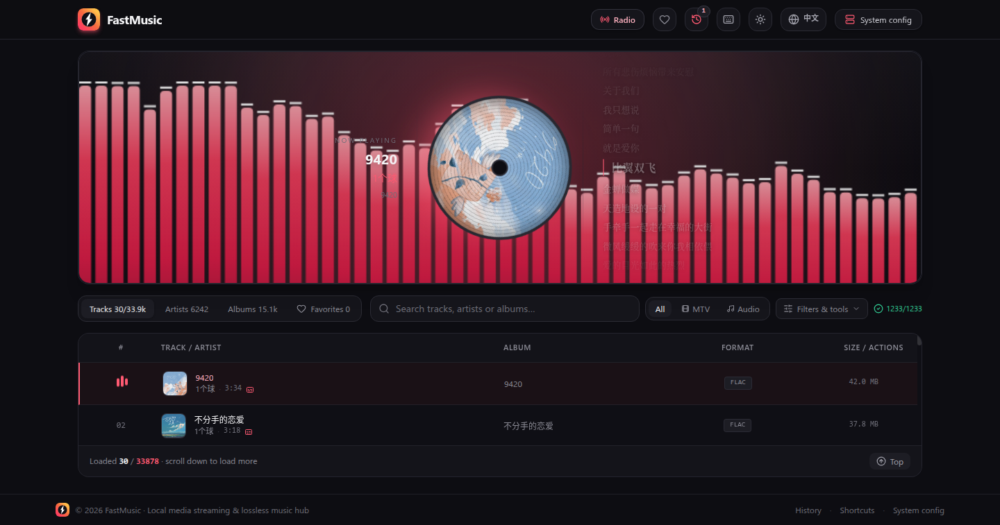

# FastMusic

[中文](README.md) · **English**

Current version **v0.1.0** · full history in [CHANGELOG.md](CHANGELOG.md)


A local music / MTV streaming player. **React SPA + Express media backend**: it scans your local music directories, streams files over HTTP Range requests, and ships a real-time spectrum visualizer plus a 10-band equalizer.

[](LICENSE)
[](https://github.com/aifeifei798/FastMusic/releases)
[](https://github.com/aifeifei798/fastmusic/pkgs/container/fastmusic)
[](https://github.com/aifeifei798/FastMusic/actions/workflows/docker.yml)



> Screenshot: bar spectrum + spinning vinyl (NetEase cover art) + a NetEase lyric rail on the right (current line centred and highlighted), with the media library below.

```
Browser (React SPA)  ⇄  Express (server.ts)  ⇄  local music directories
                        │
                        ├─ incremental scan + persisted index (fastmusic_db.json)
                        ├─ .mkv → MP4 remux / VP9 transcode sidecars
                        ├─ three-tier cover resolution + disk cache (covers/)
                        ├─ lyric resolution + disk cache (lyrics/)
                        └─ /api/stream/:id (HTTP 206 Range streaming)
```

## ✨ Features

- **Library scanning**: incremental scans (already-indexed, unchanged files are skipped); corrupt or undecodable files are excluded; the index is persisted, so a restart keeps it.
- **Browse & search**: browse by artist / album / track, keyword search (debounced, with a hit counter; the artist and album tabs follow the search box too), paginated loading, A–Z index, radio mode, play history, favorites; server-side sorting (title / artist / album / duration / size / file date / random) and standard vs compact row density; the artist / album grids scroll independently and render 120 cards at a time. The toolbar's "Filters & tools" dropdown holds Transcoded only / Lyrics only / sort / row density / prefetch covers / prefetch lyrics; every toolbar entry is icon-only (tabs, media type, filters, back-to-top) with names and counts in tooltips, so it fits on a narrow screen. The whole-library `.mkv` transcode summary lives in the System config dialog.
- **MTV playback**: Chrome cannot demux Matroska (`.mkv`), so the server handles each file according to its video codec:
  - video already **H.264** → pure remux to MP4 (`-c copy`, sub-second, almost zero CPU);
  - video is **AV1 / HEVC** → remux to WebM (AV1/VP9 streams decode fine in Chrome); only unknown codecs fall back to a VP9 + Opus re-encode;
  - once a sidecar is cached it is served through the normal 206 Range path, so seeking is smooth.
- **Album covers**: three-tier fallback — ① embedded cover art (ID3 APIC / Vorbis Picture, no network) ② iTunes Search API (`artworkUrl100` → 600×600) ③ NetEase search + album detail (`?param=500y500` makes the CDN resize it). Candidates are scored on title / artist / album / duration and the best one is downloaded; results are cached in `covers/<id>.<ext>` with an index in `fastmusic_covers.json` (both gitignored). The middle column of the player is a **rotating vinyl record** (groove texture + centred cover, one turn every 14 s while playing); list rows and artist/album cards show covers too. The toolbar's "Prefetch covers" button resolves the loaded list in batches (concurrency 8, max 200 ids), and the artist / album tabs backfill avatars automatically (batch resolve of `cover_track_id`, with "Cover backfill: X / N matched" in the toolbar).
- **Audio playback**: the video.js audio graph is `source → 10 BiquadFilter EQ stages → boostGain → analyser → destination`; five visual modes — bars / waveform / halo / mirrored / **none**; EQ state is persisted in localStorage.
- **Volume boost ×2**: default volume is 70% and the ×2 boost is **on by default** (implemented with a GainNode in the audio graph, persisted in `fastmusic_boost`; no stored value means on). On desktop and phones the toggle is in the popup volume panel header.
- **Auto-hiding control bar**: while playing, the control pill hides after 3.5 s without mouse movement, reappears when the pointer enters the player, and hides immediately when it leaves (same behaviour for audio and video). In fullscreen the cursor is hidden too.
- **Resume playback + volume memory**: the play position is recorded every 10 s (`localStorage('fastmusic_resume')`, capped at 300 entries); reopening the same track continues from the last mid-track position (only when it is >10 s in and >5 s from the end), with a "Resuming at 0:42" note in the info column. Volume is persisted in `localStorage('fastmusic_volume')`, default 70%. The volume entry in the control capsule is an **icon + percentage button**; clicking it opens a **large vertical fader panel**. On phones the panel fills the player area; on desktop it floats above the control capsule without covering the video. It has 25/50/75 tick marks, a large percentage readout, 20/40/60/80/100 % presets, −5 %/+5 % fine trim and the ×2 boost / mute buttons (`Esc` or `×` closes it). When the OS requests reduced motion the visualizer drops to ~15 fps and CSS animations are degraded — the vinyl record is the exception, it only spins slower (40 s per turn) instead of stopping.
- **Lyrics**: NetEase lyric rail (current line centred, neighbouring lines faded), toggled with the Captions button or `L`; the "Aa" panel adjusts font size and (for video) the lyric column width. The "Lyrics only" filter reads the server-side lyric cache, and rows with lyrics show a badge.
- **Whole-library cache jobs (System config)**: the System config panel in the header/footer has four background jobs — cache covers for every track/MTV, every artist, every album, and lyrics for every track/MTV. Jobs run on the server (they keep going after you close the dialog), the progress bar, hit/miss counters and ETA refresh every 2 s, and already-cached entries are skipped, so re-running only fills in what is new. After a manual stop it shows "Stopped · N left" and the next run continues from the remainder.
- **Keyboard shortcuts**: `Space` play/pause, `←`/`→` rewind/forward 10 s, `↑`/`↓` volume, `M` mute, `F` fullscreen, `J`/`K` previous/next, `S` favorite, `L` lyrics, `R` radio, `V` cycle visualizer mode, `?` shortcut panel, `Esc` to close.
- **Light / dark themes**: the Sun/Moon button in the header switches themes; the preference is stored in `localStorage('fastmusic_theme')` and first visits follow `prefers-color-scheme`. Every colour is a semantic token in `src/index.css` (`app / surface / line / ink / accent / amber / stage / viewport / pill / lyric-ink …`), so `[data-theme="light"]` only overrides variables and the whole app reskins; components never hardcode `neutral-` or `rose-` colours. The light theme is Apple-ish (near-black text, white cards, hairline borders, restrained rose), the dark theme carries rose/amber warmth that matches the logo; the `<video>` viewport stays dark in both themes, only the stage background lightens.
- **Interface language**: the Globe button in the header switches between Chinese and English. Strings are looked up through `src/utils/i18n.ts` (`t('中文原文', { vars })`), so the Chinese source stays the single source of truth and any untranslated string simply stays Chinese. The choice is persisted in `localStorage('fastmusic_lang')`.
- **Phone layout (<768px)**: narrow viewports switch structure, not just styling — the player collapses into a "now playing" pill (cover + title/artist + time + prev/play/next + expand) so the list gets the vertical space back; when expanded the audio stage becomes a two-column "vinyl left + info right + lyric strip" grid; the header moves History/Shortcuts/Language into a "More" menu, the footer is hidden, the media-type switch moves into the Filters & tools menu, the EQ and lyric-style panels become full-width sheets, rows default to compact density, and swiping left/right on the player viewport or a list row changes track.
- **Styling**: everything is Tailwind utility classes (including arbitrary variants and arbitrary properties); `src/index.css` contains only two `@import`s plus the theme token block, no hand-written rules.

## 🚀 Quick start

**Prerequisites**

- Node.js 18+
- `ffmpeg` and `ffprobe` on PATH (used for `.mkv` remux/transcode and duration probing)

```bash
./server.sh start        # npm install, runs in background, health-checks /api/health
```

Open `http://localhost:3000`, add your music directories in **System config**, then scan (or set `MEDIA_DIRS="/music,/mtv"` before starting).

Other commands:

```bash
./server.sh stop | restart | status | logs | install
```

## 🐳 Docker / Compose deployment

Prebuilt images live on GitHub Container Registry: **`ghcr.io/aifeifei798/fastmusic:latest`** (rebuilt on every push to `main`; later `vX.Y.Z` tags produce matching image tags). The image ships Node 22 + `ffmpeg` + `fd-find` and runs with `NODE_ENV=production`, serving the prebuilt `dist/`.

```bash
git clone https://github.com/aifeifei798/FastMusic.git
cd FastMusic
mkdir -p media/music media/mtv     # or point at your own music directories
docker compose up -d               # builds locally on first run; drop `build: .` to use the prebuilt image
docker compose logs -f             # scan / transcode logs
```

Open `http://localhost:3000` → **System config** → scan.

**Mounting notes**

- **Media directories must be writable**: the `.mkv` sidecars (`foo.mkv.webm` / `foo.mkv.mp4`) are written next to the source file, so `:ro` will break playback of `.mkv`.
- **Index and caches are persisted**: `fastmusic_db.json`, `covers/`, `lyrics/`, `fastmusic_covers.json` and `fastmusic_lyrics.json` are written under `DATA_DIR` (`/data` in the container) and kept in the named volume `fastmusic_data`, so restarting the container keeps the library.
- To mount real host directories, replace `./media/music` with an absolute path such as `/home/you/Music` and set `MEDIA_DIRS` to the corresponding **in-container** path.
- Without compose:

```bash
docker run -d --name fastmusic -p 3000:3000 \
  -v /home/you/Music:/media/music \
  -v fastmusic_data:/data \
  -e MEDIA_DIRS=/media/music \
  ghcr.io/aifeifei798/fastmusic:latest
```

The image is built automatically by GitHub Actions (`.github/workflows/docker.yml`): pushes to `main` produce `:latest`, `vX.Y.Z` tags produce `:vX.Y.Z`, and both are pushed to GHCR.

## ⚙️ Configuration

| Environment variable | Default | Description |
|---|---|---|
| `PORT` | `3000` | Server port |
| `DATA_DIR` | next to `server.ts` | Where the index and caches are stored (`fastmusic_db.json` / `covers/` / `lyrics/` / `fastmusic_covers.json` / `fastmusic_lyrics.json`). In Docker it defaults to `/data`, so a mounted volume keeps them across restarts |
| `MEDIA_DIRS` | empty | Pre-seeded scan directories, comma or semicolon separated, e.g. `MEDIA_DIRS="/music,/mtv"`; you can also add them in the System config UI or via `POST /api/directories` (persisted in `fastmusic_db.json`) |
| `PRETRANCODE_MKV` | on | Set to `0` to disable the background pre-transcode queue for `.mkv` files at startup (on-demand transcoding still works) |
| `SCAN_CONCURRENCY` | `8` | Number of parallel metadata-parsing workers (music-metadata is the bottleneck; 8 workers ≈ 5× faster) |
| `TRANCODE_CONCURRENCY` | `3` | How many `.mkv` files are remuxed/transcoded at once |
| `COVER_PREFETCH_CONCURRENCY` | `8` | Concurrency of the whole-library cover job |
| `COVER_PREFETCH_DELAY_MS` | `80` | Per-item throttle for the cover job |
| `LYRIC_PREFETCH_CONCURRENCY` | `3` | Concurrency of the whole-library lyric job (NetEase rate-limits high-frequency requests, so keep it low) |
| `LYRIC_PREFETCH_DELAY_MS` | `200` | Per-item throttle for the lyric job |
| `NODE_ENV` | dev | In `production` the server serves the prebuilt `dist/`, otherwise it embeds a Vite dev server |

Scan directories and the whole-library cache jobs are configured in System config (`SystemConfigModal`), or directly through the API.

## 📂 Project layout

```
server.ts              # single entrypoint: API + streaming + transcode engine
server.sh              # deployment script (start/stop/restart/status/logs)
Dockerfile             # production image (Node 22 + ffmpeg + fd-find, serves dist/)
docker-compose.yml     # compose deployment (media mounts + DATA_DIR volume)
src/
  main.tsx / App.tsx   # SPA entry, central UI and playback/library state
  components/
    VideoJsPlayer.tsx  # player + audio graph (EQ/analyser) + control bar
    AudioVisualizer.tsx# spectrum visualizer (pure consumer, reads window._fastMusicAnalyser)
    LibraryView.tsx    # media library list (internal scrolling + incremental loading)
    SystemConfigModal.tsx # scan directories + whole-library cover/lyric jobs
    ...
  services/api.ts      # client API singleton
  utils/ui.ts          # shared Tailwind class constants (scrollbar styles)
  utils/theme.ts       # canvas / placeholder gradients per theme (VISUALIZER_PALETTE, coverGradient)
  utils/i18n.ts        # Chinese → English UI string dictionary + t() helper
  index.css            # Tailwind entry + semantic theme tokens (dark default, [data-theme=light] overrides)
  types/media.ts       # shared types, matching the server response shapes
```

## 🔌 API

| Route | Description |
|---|---|
| `GET /api/health` | Health check |
| `GET /api/directories` / `POST /api/directories` | List / add scan directories |
| `POST /api/scan` | Incremental scan; `?force=1` clears the library and rescans everything |
| `GET /api/artists` | Artist list (includes `avatar_url` for cached covers and `cover_track_id` so the client can backfill avatars) |
| `GET /api/albums` | Album list (includes `cover_url` / `cover_track_id`) |
| `GET /api/tracks` | Track list with filters and `limit/offset` or `page/page_size`; `sort=title|artist|album|duration|size|mtime|random` (random uses `seed`); `ready_only=1` returns only directly playable entries (non-`.mkv`, or sidecar ready); `has_lyrics=1` returns only entries that hit the lyric cache |
| `GET /api/radio` | Radio mode |
| `GET /api/tracks/:id` | Track details |
| `GET /api/stream/:id` | Streaming playback (206 Range; `.mkv` is remuxed/transcoded automatically) |
| `GET /api/transcode/:id` | Transcode job status (used by the client progress badge) |
| `GET /api/transcode/summary` | Whole-library `.mkv` remux progress: `{total_mkv, ready, running, queued, pending, error}` |
| `GET /api/transcode/status?ids=a,b,c` | Read-only batch status (the list polls every 10 s; never starts a job) |
| `GET /api/lyrics` | NetEase lyric proxy: `?title=&artist=&duration=` (auto search match) or `?id=<NetEase song id>`; returns `{found, lyric, tlyric, romalrc}` |
| `POST /api/lyrics/prefetch` | `{ids:[...]}` batch lyric resolution (concurrency 3 + 200 ms per item, max 200 ids), returns `{requested, resolved, cached, lyrics:{id:bool}}` |
| `GET /api/cover/:id` | Cover image bytes (embedded → iTunes → NetEase, disk cached); `?local=1` only reads embedded art without going online; responses carry `X-Cover-Source` and `Cache-Control: max-age=31536000` |
| `POST /api/cover/prefetch` | `{ids:[...]}` batch resolution (concurrency 8, max 200 ids), returns `{requested, resolved, cached, covers:{id:url|null}}` |
| `POST /api/cache/run` | `{kind:"track_covers"|"artist_covers"|"album_covers"|"track_lyrics"}` starts a whole-library cache job (runs in the background, already-cached entries are skipped) |
| `GET /api/cache/status` | Progress of the four jobs `{kind,label,total,done,hits,misses,errors,running,stopped,remaining,etaSeconds}` + library stats `{tracks,artists,albums,covers_cached,cover_misses,lyrics_cached,lyric_hits}` |
| `POST /api/cache/stop` | `{kind}` stops a job (cached entries are kept; the next run continues with the remainder) |

## 📝 Known issues

- The music files themselves are not in the repository; the index `fastmusic_db.json`, the transcode cache, the cover cache (`covers/` + `fastmusic_covers.json`), the lyric cache (`lyrics/` + `fastmusic_lyrics.json`) and logs are all gitignored.
- `.webm` is both an audio and a video container: the server classifies by what actually decodes, and the client decides picture-vs-visualizer from `videoWidth > 0`.
- The first full scan is slow (music-metadata parses files one by one); later incremental scans are fast.
- Lyrics come from NetEase's plain API (`music.163.com/api/song/lyric`), proxied and cached by the server (`fastmusic_lyrics.json`, gitignored). If your local titles/artists differ from NetEase, you may match a cover version or find no lyrics.
- Covers come from the public iTunes / NetEase endpoints (NetEase has dropped some mainstream artists; when nothing is found a gradient vinyl placeholder is shown). The image cache `covers/` and index `fastmusic_covers.json` are gitignored.
- There is no test suite; `npm run lint` is just `tsc --noEmit`.
- The server caches `/api/tracks` sort results and `.mkv` sidecar stats, invalidated automatically when the library changes. The library index is still a single JSON file (34k entries ≈ 13 MB, ~100 ms to load) — no external database needed.

## 🔖 Brand assets

Logo geometry: rounded square + vinyl record concentric grooves + a lightning bolt ("fast"). Both themes share the same geometry, only the colours change.

| File | Purpose |
|---|---|
| `public/logo.svg` | Dark-page lockup: gradient mark (rose → amber) + **white** wordmark, transparent background |
| `public/logo-dark.svg` | Light-page lockup: gradient mark + **dark** wordmark `#0b0b12`, transparent background |
| `public/logo-light.svg` | **Light theme / Apple-style** lockup: near-black mark `#1d1d1f` (no gradient) + near-black wordmark (Inter / SF Pro stack), transparent background |
| `public/logo-mark.svg` | The mark itself: gradient rounded square + vinyl grooves + white lightning bolt |
| `public/logo-mark-light.svg` | Light-theme mark: near-black rounded square + very faint grooves + white bolt |
| `public/logo-mark-line.svg` | Line version (`currentColor`): thin ring + solid bolt, for small icons / monochrome print |
| `public/logo-mark-mono.svg` | Monochrome version (`currentColor`): thick ring + solid bolt, works on light and dark backgrounds |
| `public/favicon.svg` | 16px optimised version (inner grooves removed, bolt thickened) |
| `docs/logo.png` (640×160) | Dark card banner, used at the top of the README and as `og:image` |
| `docs/logo-light.png` (640×160) | Light card banner (white background, near-black text, grey subtitle) |
| `docs/logo-dark.png` (452×128) / `docs/logo-light-lockup.png` (432×128) / `docs/logo-mark-light.png` (256×256) / `docs/logo-mark.png` (256×256) | Bitmap exports (transparent background) |
| `docs/preview-zh.png` / `docs/preview-en.png` (1440×757) | README UI screenshots (Chinese / English interface) |

- The header/footer logo is an inline SVG (`src/components/Logo.tsx`) with the same geometry as `public/logo-mark.svg`; if you change the shape, update both.

## 📄 License

Apache License 2.0. The repository contains only program code and documentation screenshots — no music or video files. The index `fastmusic_db.json`, lyric caches, transcode caches and logs are all gitignored.
