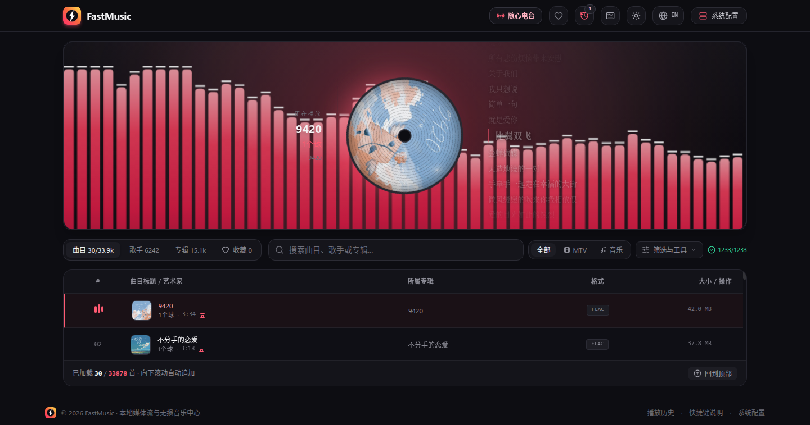

# FastMusic

**中文** · [English](README.en.md)

当前版本 **v0.1.0** · 变更历史见 [CHANGELOG.md](CHANGELOG.md)


本地音乐 / MTV 流媒体播放器。**React SPA + Express 媒体后端**,扫描本地音乐目录,通过 HTTP Range 流式播放,自带实时频谱可视化与 10 段均衡器。

[](LICENSE)
[](https://github.com/aifeifei798/FastMusic/releases)
[](https://github.com/aifeifei798/fastmusic/pkgs/container/fastmusic)
[](https://github.com/aifeifei798/FastMusic/actions/workflows/docker.yml)



> 截图: 柱状频谱 + 旋转唱片(网易云封面) + 右侧网易云歌词竖列(当前行居中高亮),下方为媒体库列表。

```
浏览器 (React SPA)  ⇄  Express (server.ts)  ⇄  本地音乐目录
                        │
                        ├─ 增量扫描 + 持久化索引 (fastmusic_db.json)
                        ├─ .mkv → MP4 remux / VP9 转码 sidecar
                        ├─ 封面三级兜底 + 磁盘缓存 (covers/)
                        ├─ 歌词解析 + 磁盘缓存 (lyrics/)
                        └─ /api/stream/:id (HTTP 206 Range 流式)
```

## ✨ 功能

- **媒体库扫描**: 增量扫描(已索引且未变化的文件跳过),损坏/无法解码的文件自动排除;索引持久化,重启不丢。
- **浏览与搜索**: 按歌手 / 专辑 / 曲目浏览,关键词搜索(防抖 + 命中数,歌手与专辑标签也跟随搜索框),分页加载,字母索引,随心电台,播放历史,收藏;服务端排序(标题 / 歌手 / 专辑 / 时长 / 大小 / 文件日期 / 随机)与标准 / 紧凑两种行密度;歌手 / 专辑网格独立滚动并按 120 张一批追加渲染。工具栏的「筛选与工具」下拉收纳 只看已转码 / 只看有歌词 / 排序 / 行密度 / 预取封面 / 预取歌词;工具栏入口全部是图标(标签 / 类型切换 / 筛选与工具 / 回到顶部),名称与数量只在 tooltip 里,窄屏也能一行装下;全库 `.mkv` 转码统计收进「系统配置」弹窗。
- **MTV 播放**: Chrome 无法直接解析 Matroska(`.mkv`)容器,服务端按视频 codec 自动处理:
  - 视频已是 **H.264** → 纯 remux 到 MP4(`-c copy`,秒级,几乎零 CPU);
  - 视频为 **AV1/HEVC** 等 → 转码为 VP9 WebM(一次性,缓存 sidecar `*.mkv.webm`);
  - 缓存命中后走普通 206 Range 流,支持平滑 seek。
- **专辑封面**: 三级兜底自动获取封面 — ① 文件内嵌封面(ID3 APIC / Vorbis Picture,零网络) ② iTunes Search API(`artworkUrl100` → 600×600) ③ 网易云搜索 + 专辑详情(`?param=500y500` 让 CDN 裁尺寸)。候选按标题/歌手/专辑/时长打分选最佳,结果缓存到 `covers/<id>.<ext>` + 索引 `fastmusic_covers.json`(均已 gitignore)。播放区中间列是**旋转唱片**(黑胶纹路 + 中心封面,播放时 14s 一圈),列表行与歌手/专辑卡片也显示封面;工具栏「预取封面」按钮批量解析当前列表(并发 8,最多 200 条),歌手 / 专辑标签渲染卡片时自动补全头像(后台批量解析 `cover_track_id`,工具栏显示「封面补全: 命中 X / N」)。
- **音频播放**: 视频.js 音频图 `source → 10 段 BiquadFilter EQ → boostGain → analyser → destination`;条形 / 波形 / 光晕环 / 对称频谱 / **无** 五种视觉模式;EQ 状态持久化到 localStorage。
- **音量增强 ×2**: 默认音量 70% + **默认开启**的 ×2 增强(靠音频图里的 GainNode 实现,状态持久化到 localStorage `fastmusic_boost`,没有记录时视为开启)。桌面和窄屏都在弹出音量面板的 header 里切换。
- **控制栏自动隐藏**: 播放中 3.5 秒无鼠标操作自动隐藏,鼠标进入播放区重新显示,离开立即隐藏(音频与视频统一);窄屏非全屏时控制栏常显,避免手机上进度条无法拖。
- **断点续播 + 音量记忆**: 断点续播默认关闭,可在「系统配置」里开启;开启后播放每 10 秒记录一次位置(`localStorage('fastmusic_resume')`,最多 300 条),重新打开同一曲目时从上次的中途位置继续(只在 >10s 且离结尾 >5s 时恢复,左列显示「继续播放 0:42」提示)。音量持久化到 `localStorage('fastmusic_volume')`,默认 70%。控制栏的音量入口是**图标 + 百分比按钮**,点击弹出**大推杆音量面板**:窄屏展开时铺满播放区,窄屏折叠时挂在「正在播放」胶囊下方,桌面浮在控制胶囊上方;面板里有大推杆(25/50/75 刻度)+ 大号百分比 + 20/40/60/80/100% 预设 + ±5% 微调 + ×2 增强 / 静音,`Esc` 或 `×` 关闭。系统开启「减少动态效果」时频谱降到 ~15fps、CSS 动画自动降级(唱片旋转只放慢,不会停)。
- **歌词**: 网易云歌词竖列(当前行居中高亮,上下行淡出),控制栏 Captions 按钮或 `L` 切换,"Aa" 面板可调字号与(视频时)歌词列宽;「只看有歌词」筛选走服务端歌词缓存,列表行有歌词图标 badge。
- **全库缓存任务(系统配置)**: 页头 / 页脚的「系统配置」面板里有四个后台任务 —— 缓存全部歌曲 / MTV 封面、全部歌手封面、全部专辑封面、全部歌曲 / MTV 歌词。任务在服务端后台跑(关闭弹窗继续执行),每 2 秒刷新进度条、命中 / 无结果计数与剩余时间估算;已缓存的条目自动跳过,所以重复点击只是"补齐新增内容"。手动停止后显示「已停止 · 剩余 N 条」,下次再启动从剩余部分继续。
- **快捷键**: `Space` 播放/暂停, `←`/`→` 快退/快进 10 秒, `↑`/`↓` 音量, `M` 静音, `F` 全屏, `J`/`K` 上一首/下一首, `S` 收藏, `L` 歌词, `R` 随心电台, `V` 切换频谱模式, `?` 快捷键面板, `Esc` 关闭。
- **深浅主题**: 页头的 Sun/Moon 按钮切换深色 / 浅色主题,偏好持久化到 `localStorage('fastmusic_theme')`,首次访问跟随系统 `prefers-color-scheme`。所有颜色都是 `src/index.css` 里的语义 token(`app / surface / line / ink / accent / amber / stage / viewport / pill / lyric-ink ...`),`[data-theme="light"]` 覆盖变量即全站换肤,组件里不写 `neutral-` / `rose-` 这类硬编码色。浅色主题是 Apple 风(近黑文字 + 白卡片 + hairline 边框 + 克制 rose),深色主题带 rose/amber 暖调呼应徽标;视频 `<video>` 视口在两个主题都保持深色,只有舞台背景变浅。
- **界面语言**: 页头的 Globe 按钮切换中文 / English。文案通过 `src/utils/i18n.ts` 的 `t('中文原文', { vars })` 查表(key 就是中文原文),未收录的文案自动保持中文;语言偏好持久化到 `localStorage('fastmusic_lang')`,`index.html` 首屏前设置 `<html lang>`。服务端返回的中文提示(扫描完成 / 错误 detail)也通过 `tServerMessage()` 翻译。
- **手机布局（<768px）**: 窄屏自动切换结构 —— 播放器默认折叠成一条「正在播放」胶囊（旋转唱片 / 封面 + 标题 / 歌手 + 时间 + 上一首 / 播放 / 下一首 / 收藏 + 展开），把垂直空间还给列表；展开后音频舞台是「唱片左 + 信息右 + 歌词横向带」两列网格；页头历史 / 快捷键 / 语言收进「更多」菜单，页脚隐藏，媒体类型切换收进「筛选与工具」菜单，均衡器与歌词样式变成全宽 sheet，行密度默认紧凑；播放视口与列表行支持左右滑动切歌（左滑下一首 / 右滑上一首）。
- **样式**: 全部用 Tailwind utility 类(含 arbitrary variant / arbitrary property),`src/index.css` 只有两个 `@import` + 主题令牌块,没有手写规则。

## 🚀 快速开始

**前置条件**

- Node.js 18+
- `ffmpeg` 与 `ffprobe` 在 PATH 中(用于 `.mkv` remux/转码与时长探测)

```bash
./server.sh start        # 自动 npm install, 后台运行, 健康检查 /api/health
```

打开 `http://localhost:3000`,在「系统配置」里添加音乐目录,然后点扫描(或启动前设置 `MEDIA_DIRS="/music,/mtv"`)。

其他命令:

```bash
./server.sh stop | restart | status | logs | install
```

## 🐳 Docker / Compose 部署

预构建镜像在 GitHub Container Registry: **`ghcr.io/aifeifei798/fastmusic:latest`**(每次 push 到 `main` 自动重建;之后的 `vX.Y.Z` tag 也会产出同名镜像 tag)。镜像内含 Node 22 + `ffmpeg` + `fd-find`, 以 `NODE_ENV=production` 运行(直接 serve 构建好的 `dist/`)。

```bash
git clone https://github.com/aifeifei798/FastMusic.git
cd FastMusic
mkdir -p media/music media/mtv     # 或改成你自己的音乐目录
docker compose up -d               # 首次会本地 build; 有预构建镜像时可删掉 compose 里的 build: .
docker compose logs -f             # 扫描 / 转码日志
```

打开 `http://localhost:3000` → 「系统配置」 → 扫描。

**挂载要点**

- **媒体目录必须可写**: `.mkv` 的 sidecar(`foo.mkv.webm` / `foo.mkv.mp4`) 写在源文件旁边, 所以不能加 `:ro`。
- **索引与缓存持久化**: `fastmusic_db.json`、`covers/`、`lyrics/`、`fastmusic_covers.json`、`fastmusic_lyrics.json` 都写到 `DATA_DIR`(容器内默认 `/data`), 由 named volume `fastmusic_data` 保存, 容器重启不丢。
- 想挂载宿主机真实目录: 把 compose 里的 `./media/music` 换成 `/home/you/Music` 之类的绝对路径, 同时把 `MEDIA_DIRS` 改成对应的**容器内**路径。
- 不用 compose 也可以:

```bash
docker run -d --name fastmusic -p 3000:3000 \
  -v /home/you/Music:/media/music \
  -v fastmusic_data:/data \
  -e MEDIA_DIRS=/media/music \
  ghcr.io/aifeifei798/fastmusic:latest
```

镜像由 GitHub Actions(`.github/workflows/docker.yml`) 自动构建: push 到 `main` 产出 `:latest`, 打 `vX.Y.Z` tag 产出 `:vX.Y.Z`, 推到 GHCR。

## ⚙️ 配置

| 环境变量 | 默认 | 说明 |
|---|---|---|
| `PORT` | `3000` | 服务端口 |
| `DATA_DIR` | 与 `server.ts` 同目录 | 索引与缓存的持久化位置(`fastmusic_db.json` / `covers/` / `lyrics/` / `fastmusic_covers.json` / `fastmusic_lyrics.json`)。Docker 里默认 `/data`, 挂载卷即可 |
| `MEDIA_DIRS` | 空 | 预置扫描目录,逗号或分号分隔,例如 `MEDIA_DIRS="/music,/mtv"`;也可在「服务器配置」UI 或 `POST /api/directories` 添加(配置持久化到 `fastmusic_db.json`) |
| `PRETRANCODE_MKV` | 开启 | 设为 `0` 时禁用启动后的 mkv 后台预转码队列(按需转码仍生效) |
| `SCAN_CONCURRENCY` | `8` | 扫描时并行解析文件 worker 数(music-metadata 是瓶颈,8 并发 ≈ 5x 加速) |
| `TRANCODE_CONCURRENCY` | `3` | 同时转码 / remux 的 `.mkv` 数量 |
| `COVER_PREFETCH_CONCURRENCY` | `8` | 全库封面任务并发数 |
| `COVER_PREFETCH_DELAY_MS` | `80` | 全库封面任务每条之间的节流间隔 |
| `LYRIC_PREFETCH_CONCURRENCY` | `3` | 全库歌词任务并发数(网易云对高频请求会限流,别调太高) |
| `LYRIC_PREFETCH_DELAY_MS` | `200` | 全库歌词任务每条之间的节流间隔 |
| `NODE_ENV` | dev | `production` 时服务预构建的 `dist/`,否则内嵌 Vite dev server |

扫描目录与全库缓存任务都在「系统配置」(SystemConfigModal)里配置,也可用 `POST /api/directories` 等 API 直接操作。

## 📂 目录结构

```
server.ts              # 单入口: API + 流式服务 + 转码引擎
server.sh              # 部署脚本 (start/stop/restart/status/logs)
Dockerfile             # 生产镜像 (Node 22 + ffmpeg + fd-find, serve dist/)
docker-compose.yml     # Compose 部署 (媒体挂载 + DATA_DIR 卷)
src/
  main.tsx / App.tsx   # SPA 入口, 中央 UI 与播放/库状态
  components/
    VideoJsPlayer.tsx  # 播放器 + 音频图 (EQ/analyser) + 控制栏
    AudioVisualizer.tsx# 频谱可视化 (纯消费者, 读 window._fastMusicAnalyser)
    LibraryView.tsx    # 媒体库列表 (内部滚动 + 增量加载)
    SystemConfigModal.tsx # 扫描目录 + 全库封面/歌词缓存任务
    ...
  services/api.ts      # 客户端 API 单例
  utils/ui.ts          # 共享 Tailwind 类常量(滚动条样式)
  utils/theme.ts       # canvas / 占位渐变的主题配色 (VISUALIZER_PALETTE, coverGradient)
  utils/i18n.ts        # 中文 → 英文 UI 文案字典 + t() 助手
  index.css            # Tailwind 入口 + 语义主题令牌(深色默认, [data-theme=light] 覆盖)
  types/media.ts       # 共享类型, 与 server 响应形状一致
```

## 🔌 API

| 路由 | 说明 |
|---|---|
| `GET /api/health` | 健康检查 |
| `GET /api/directories` / `POST /api/directories` | 列出 / 添加扫描目录 |
| `POST /api/scan` | 增量扫描;`?force=1` 清空并全量重扫 |
| `GET /api/artists` | 歌手列表(含 `avatar_url` 已缓存封面 + `cover_track_id` 用于前端补全头像) |
| `GET /api/albums` | 专辑列表(含 `cover_url` / `cover_track_id`) |
| `GET /api/tracks` | 曲目列表,支持过滤 + `limit/offset` 或 `page/page_size`;`sort=title|artist|album|duration|size|mtime|random`(random 用 `seed`);`ready_only=1` 只返回可直接播的条目(非 `.mkv` 或 sidecar 已就绪);`has_lyrics=1` 只返回歌词缓存里命中网易云的条目 |
| `GET /api/radio` | 随心电台 |
| `GET /api/tracks/:id` | 曲目详情 |
| `GET /api/stream/:id` | 流式播放(206 Range;`.mkv` 自动 remux/转码) |
| `GET /api/transcode/:id` | 转码任务状态(前端显示进度) |
| `GET /api/transcode/summary` | 全库 `.mkv` 换容器进度汇总:`{total_mkv, ready, running, queued, pending, error}` |
| `GET /api/transcode/status?ids=a,b,c` | 批量只读状态(列表每 10s 轮询,不触发转码) |
| `GET /api/lyrics` | 网易云歌词代理:`?title=&artist=&duration=`(自动搜索匹配)或 `?id=<网易云歌曲ID>`;返回 `{found, lyric, tlyric, romalrc}` |
| `POST /api/lyrics/prefetch` | `{ids:[...]}` 批量解析歌词(并发 3 + 每条 200ms 节流,最多 200 条),返回 `{requested, resolved, cached, lyrics:{id:bool}}` |
| `GET /api/cover/:id` | 封面图片字节(内嵌 → iTunes → 网易云三级兜底,磁盘缓存);`?local=1` 只读内嵌不联网;响应带 `X-Cover-Source` 与 `Cache-Control: max-age=31536000` |
| `POST /api/cover/prefetch` | `{ids:[...]}` 批量解析(并发 8,最多 200 条),返回 `{requested, resolved, cached, covers:{id:url\|null}}` |
| `POST /api/cache/run` | `{kind:"track_covers"\|"artist_covers"\|"album_covers"\|"track_lyrics"}` 启动全库缓存任务(后台执行,已缓存的条目自动跳过) |
| `GET /api/cache/status` | 四个任务的进度 `{kind,label,total,done,hits,misses,errors,running,stopped,remaining,etaSeconds}` + 全库统计 `{tracks,artists,albums,covers_cached,cover_misses,lyrics_cached,lyric_hits}` |
| `POST /api/cache/stop` | `{kind}` 停止任务(已缓存的条目保留,下次启动从剩余部分继续) |

## 📝 已知事项

- 音乐文件本身不在仓库内;索引 `fastmusic_db.json`、转码缓存 `mtv_cache/`、封面缓存 `covers/` + `fastmusic_covers.json`、歌词缓存 `lyrics/` + `fastmusic_lyrics.json`、日志均已 gitignore。
- `.webm` 既是音频容器也是视频容器:服务端按实际解码结果分类,客户端用 `videoWidth > 0` 判断画面 vs 频谱。
- 首次全量扫描较慢(music-metadata 逐文件解析);后续增量扫描很快。
- 歌词来自网易云明文接口(`music.163.com/api/song/lyric`),服务端代理 + 缓存(`fastmusic_lyrics.json`,已 gitignore);本地曲库标题/歌手若与网易云不一致,可能匹配到翻唱版本或无歌词。
- 封面来自 iTunes / 网易云公开接口(网易云对部分主流歌手已下架,找不到时显示渐变唱片占位);图片缓存 `covers/` 与索引 `fastmusic_covers.json` 均已 gitignore。
- 无测试套件;`npm run lint` 即 `tsc --noEmit`。
- 服务端缓存 `/api/tracks` 的排序结果与 `.mkv` sidecar 状态,扫描/增删条目后自动失效;曲库索引仍是单个 JSON 文件(34k 条目约 13 MB,加载 ~100 ms),无需外部数据库。

## 🔖 品牌资源

徽标几何: 圆角方 + 黑胶唱片同心纹路 + 闪电(“快”), 深浅主题共用同一几何, 只换配色。

| 文件 | 用途 |
|---|---|
| `public/logo.svg` | 深色页面 lockup: 渐变徽标(rose → amber) + **白色** wordmark, 透明背景 |
| `public/logo-dark.svg` | 浅色页面 lockup: 渐变徽标 + **深色** wordmark `#0b0b12`, 透明背景 |
| `public/logo-light.svg` | **浅色主题 / Apple 风** lockup: 近黑徽标 `#1d1d1f`(无渐变) + 近黑 wordmark(Inter / SF Pro 字体栈), 透明背景 |
| `public/logo-mark.svg` | 徽标本体: 渐变圆角方 + 黑胶同心纹路 + 白色闪电 |
| `public/logo-mark-light.svg` | 浅色主题徽标: 近黑圆角方 + 极淡黑胶纹路 + 白色闪电 |
| `public/logo-mark-line.svg` | 线条版徽标(`currentColor`): 细圆环 + 实心闪电, 小图标 / 单色印刷通用 |
| `public/logo-mark-mono.svg` | 单色版(`currentColor`): 粗圆环 + 实心闪电, 深浅背景通用 |
| `public/favicon.svg` | 16px 优化版(去掉内圈纹路, 闪电加粗) |
| `docs/logo.png` (640×160) | 深色卡片横幅, README 顶部与 `og:image` |
| `docs/logo-light.png` (640×160) | 浅色卡片横幅(白底 + 近黑文字 + 灰色副标题) |
| `docs/logo-dark.png` (452×128) / `docs/logo-light-lockup.png` (432×128) / `docs/logo-mark-light.png` (256×256) / `docs/logo-mark.png` (256×256) | 位图导出(透明背景) |
| `docs/preview-zh.png` / `docs/preview-en.png` (1440×757) | README 界面截图(中文 / 英文 UI) |

- 页头 / 页脚的徽标是内联 SVG(`src/components/Logo.tsx`),几何与 `public/logo-mark.svg` 一致;改形状时两边要同步。

## 📄 许可

Apache License 2.0。仓库只包含程序代码与文档截图,不含任何音乐 / 视频文件;索引 `fastmusic_db.json`、歌词缓存、转码缓存与日志均已 gitignore。
